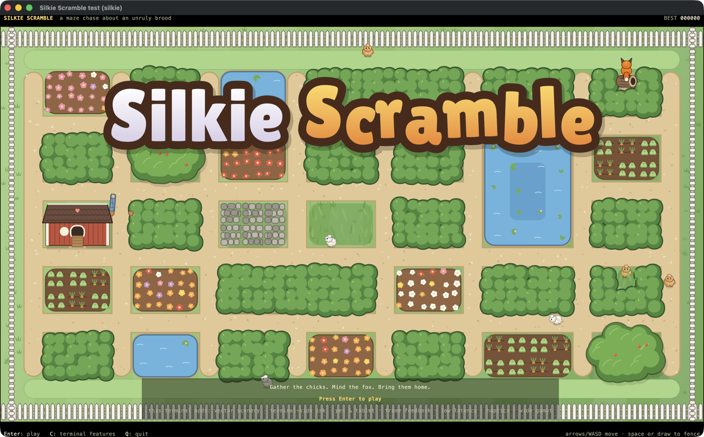
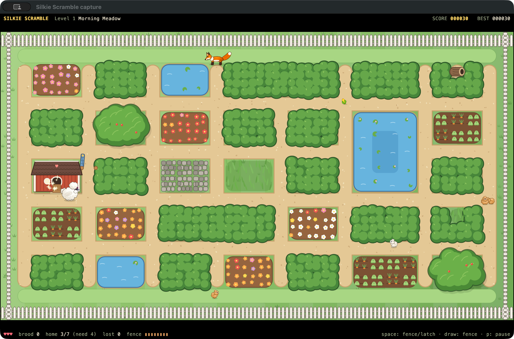
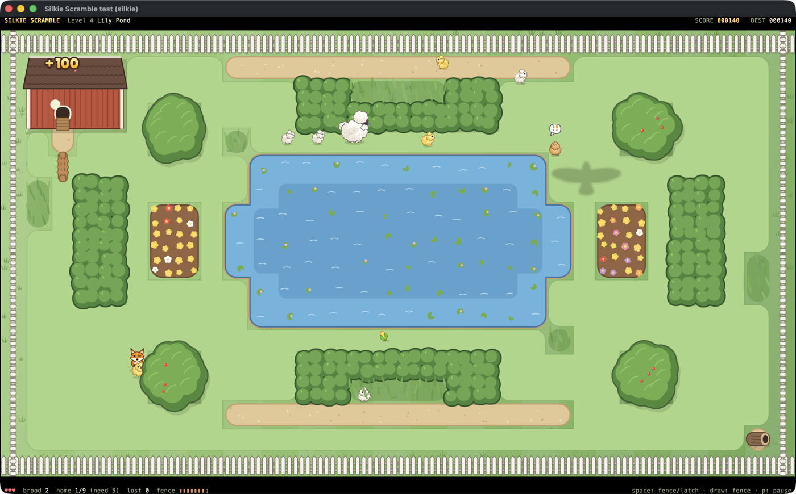
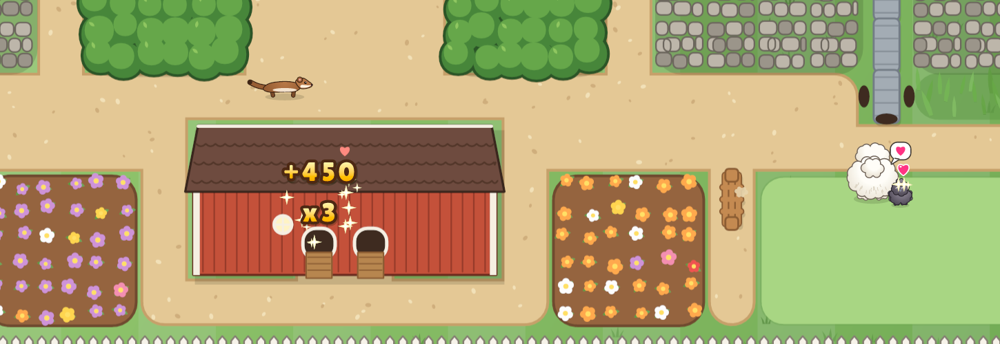

# Silkie Scramble

*Gather the chicks. Mind the fox. Bring them home.*

Open [the HTML game guide](index.html) in a browser for an illustrated overview,
terminal requirements, controls, and tablet fence-drawing instructions. The guide
also includes a gameplay video and HDR screenshots of the game’s sparkling
highlights, with standard-display fallbacks. See [capture details](docs/MEDIA.md).

Silkie Scramble is a maze-chase arcade game for the terminal, written in
Rust. You are a Silkie hen, a near-spherical pom-pom of white feathers,
in a backyard garden that has grown into a maze of hedges, flower beds,
vegetable patches and garden gates. Your chicks are wandering about. Gather
them, keep them together, and lead them home to the coop while a fox, a
weasel and a hawk try to make a meal of the stragglers.



It runs in [kitty](https://sw.kovidgoyal.net/kitty/) and in
[Silkie](https://silkie.goblinreactor.com/), a fork of kitty with extra
graphics, input and timing protocols. kitty is fully supported; Silkie makes
it better (see [Terminal support](#terminal-support)).

## Playing



Walk into a chick to gather it. Gathered chicks follow you in a wobbly
procession: they keep their own spacing, cut corners, bump into each other,
and now and then wander off after a butterfly. Lead them to the coop door
and they hop inside. Chicks that reach the coop together score together, so
a bigger brood is worth more per chick:

| delivered at once | points |
|---|---|
| 1 | 100 |
| 3 | 450 |
| 6 | 1350 |

But a bigger brood is also slower (you wait for stragglers), longer, noisier
(foxes hear a brood from further away) and harder to steer through a narrow
garden. Choosing between safe little trips and greedy big ones is the game.

The level ends when every chick is home or gone. Bring home at least half to
move on; a time bonus and a perfect-brood bonus reward doing it well.

### The predators

* **The fox** patrols, follows its nose, and investigates the peeping of a
  brood or a panicking chick. It only knows what it can see (hedges block its
  view) or hear. When it spots you it freezes for a moment with a "!" before
  it charges: that is your warning. Cleverer foxes run to where you are
  going rather than where you are, and on later levels a second fox lies in
  wait on the way to the coop when you are bringing a big brood home. A fox
  that catches a chick carries it off to its den: run it down before it gets
  there and it drops the chick (its mouth is full; it cannot bite you).
* **The weasel** lives in the drains and slips through pipes nobody else
  fits. It never goes for you, only for chicks left on their own, and it
  bolts if you come at it.
* **The hawk** circles the open lawns. Its shadow slides over its prey for
  two seconds before it stoops. Chicks in tall grass or under a tree's shade
  are safe; the brood knows this and will run for cover, as long as you
  have not led them across an open lawn.



### Fences

You can put up temporary fences to send predators the long way round.

* Draw one across a path with the mouse, a pen or a finger.
* Or press **Space** to drop a hurdle on the path behind you: on the first
  free tile, so with a brood in tow it shuts the way behind them.

Fences cost supply (the bar at the bottom right), which slowly regrows. They
fall apart after a few seconds, and a fox cut off from its quarry will chew
through one. They can never make the coop or a chick unreachable, nor pen a
predator into a corner: parts of a stroke that would are refused, marked
with a red cross.



### Gates

Some gates swing on a timer (a little red flag goes up before they close).
Latched gates, the blue ones, open and close when you press **Space** next
to them. Gates never close on anybody standing in them.

### Levels

1. **Morning Meadow**: one dozy fox; learn to gather, deliver and fence.
2. **The Orchard**: timed gates in a windbreak; a fox that anticipates.
3. **Kitchen Garden**: the weasel and its drains.
4. **Lily Pond**: open lawns, and the hawk.
5. **The Hedge Maze**: two foxes that hunt together; latched gates.
6. **Dusk**: everything at once.

After Dusk the garden starts over with cleverer predators.

### Controls

| key | action |
|---|---|
| arrows, WASD (or HJKL) | walk; the hen keeps going until she can turn the way you asked |
| Space | work a latched gate next to you, or drop a fence behind you |
| mouse drag, pen, finger | draw a fence |
| right click | abandon the fence you are drawing |
| click or tap a latched gate | work it, when the hen is next to it |
| P, Esc | pause menu |
| F2 or ` | diagnostics panel |
| Ctrl+Z | suspend (the terminal is restored; `fg` resumes) |
| Ctrl+C | quit |

## Terminal support

The game needs a terminal that implements the
[kitty graphics protocol](https://sw.kovidgoyal.net/kitty/graphics-protocol/).
Every feature is detected by asking the terminal at start-up, never by its
name or environment variables; `silkie-scramble --report` prints what your
terminal answered.

The rules, speeds, scoring and difficulty are identical everywhere. What
Silkie adds is presentation and input:

| | kitty | Silkie |
|---|---|---|
| Sprites | uploaded once, animated by moving placements | same |
| Garden | rasterized by the game, uploaded once per level and size step | a retained vector image the terminal draws; gates and fences are patches of a few hundred bytes; a resize costs nothing |
| Title lettering | bitmap | vector, crisp at any size |
| Drawing fences | mouse; the game draws a trail of dots | mouse, pen or touch; with a pen the terminal draws the ink itself, with no round trip to the game, which matters most over SSH |
| Frame pacing | timer | presentation reports from the terminal: draws exactly as fast as frames are shown, and keeps frames from piling up on a slow link |
| Input latency | normal | low-latency mode while playing |
| Menus | opaque panels | translucent panels over the garden |
| Pointer | crosshair | a little wooden stake |
| Feedback | | trackpad haptics for gathering, delivering, gates and fences |
| Colour | sRGB | wide-gamut sprites on Display P3 screens; HDR glints on sparkles, stars and hearts when Silkie's `hdr` option is `auto` or `always` |
| Display | | refresh rate, pixel scale and e-ink awareness from the display protocol |

Run with `--kitty-only` in Silkie to see the game as kitty shows it.

Inside tmux or screen the graphics protocol needs passthrough, which the game
does not attempt; run it directly in the terminal.

The game works over SSH. Images then travel inside the terminal stream
(locally they go through temporary files), so the first screen of a level
takes a moment on a slow link while the bitmaps arrive; a banner says so.
On Silkie the garden is vector and much smaller, and frame pacing adapts to
the link's round trip. See [docs/PERFORMANCE.md](docs/PERFORMANCE.md).

## Installing

You need Rust (stable, 1.85 or newer) and Cargo.

```sh
git clone <this repository>
cd silkie-scramble
cargo build --release
./target/release/silkie-scramble
```

or `cargo install --path .` to put `silkie-scramble` on your path.

Run it in kitty (0.31 or newer recommended) or Silkie. A big window with a
small font gives the garden the most pixels.

### Options

```
--seed N            replay the same game (with the same inputs)
--level N           start on level N
--diagnostics       show the diagnostics panel (F2 toggles)
--kitty-only        use only what plain kitty offers
--no-vector, --no-ink, --no-latency, --no-frame-feedback, --no-haptics, --no-hdr
                    turn off individual Silkie features
--no-tempfile       send images inline even when files would work (as over SSH)
--record FILE       record your inputs; `silkie-scramble replay FILE` re-runs them
--report            print the terminal's capabilities and exit
--autoplay          let the built-in autopilot play
--log FILE          log to a file
```

Subcommands that need no terminal:

```sh
silkie-scramble headless   # the autopilot plays every level, prints a table
silkie-scramble bench      # simulation and renderer measurements
silkie-scramble replay F   # re-runs a recording and checks the final state
```

The `netsim` binary runs the game behind a simulated network link (delay and
bandwidth limit) to see how it behaves over a slow connection:

```sh
cargo run --release --bin netsim -- --delay-ms 40 --kbps 2000 -- \
    target/release/silkie-scramble --no-tempfile
```

High scores are kept in your platform's data directory (for example
`~/Library/Application Support/com.goblinreactor.silkie-scramble/` on macOS).

## Development

```sh
cargo test                            # unit and headless simulation tests
cargo clippy --all-targets
cargo run --release --bin artgen      # repaint assets/sprites/*.png
cargo run --release --example render_level -- 0 48 level.png
cargo run --release --example preview_sheet -- hen 96 hen.png
```

* [docs/TECHNICAL.md](docs/TECHNICAL.md): architecture, the simulation and
  its AI, the renderers, and how each kitty and Silkie protocol is used.
* [docs/PERFORMANCE.md](docs/PERFORMANCE.md): measurements and how to
  reproduce them.
* [docs/DEPENDENCIES.md](docs/DEPENDENCIES.md): crates used, why, and their
  licences.
* [assets/PROVENANCE.md](assets/PROVENANCE.md): where the art, typeface and
  levels come from.
* [assets/levels/README.md](assets/levels/README.md): the level file format.

"Silkie Scramble" is a working title.
